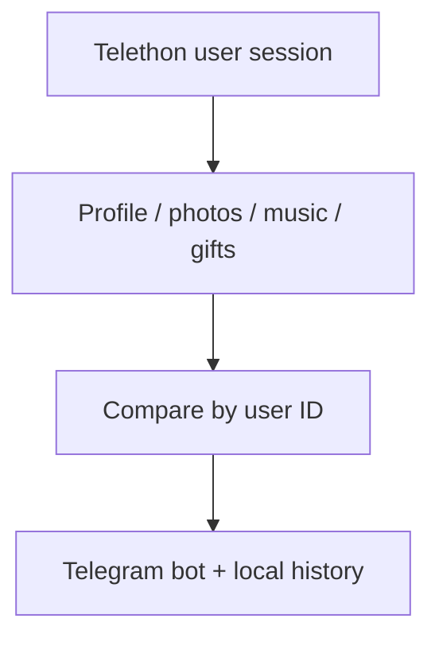

# Telegram User Monitor

[Русский](README.md) · [English](README_EN.md)

Монитор Telegram-профилей: изменения данных, фотографий, музыки и видимых подарков. Telethon читает доступные аккаунту сведения, отдельный бот отправляет уведомления администраторам; история сохраняется локально.

## Требования

- Python 3.14 или новее;
- пользовательский Telegram-аккаунт;
- `api_id` и `api_hash` из [Telegram API development tools](https://my.telegram.org);
- Telegram bot token от [@BotFather](https://t.me/BotFather);
- Telegram ID каждого администратора;
- хотя бы одна доступная цель мониторинга.

## Быстрый старт

### 1. Клонируйте репозиторий

```bash
git clone https://github.com/soroka01/Telegram-user-monitoring.git
cd Telegram-user-monitoring
```

### 2. Создайте config на Windows

```bat
start.bat
```

Первый запуск создаст `.venv` и `config.json`, затем остановится. Заполните `api_id`, `api_hash`, bot token, admin IDs и targets; phone нужен только для входа кодом.

### 3. Авторизуйте user session

Рекомендуемый QR-вход:

```bat
login.bat
```

Откройте Telegram на телефоне:

```text
Настройки → Устройства → Подключить устройство
```

Отсканируйте QR из консоли. Если включён 2FA, Telethon дополнительно запросит пароль.

Вход кодом вместо QR:

```powershell
.\.venv\Scripts\python.exe login.py --code
```

Код приходит в официальный чат **Telegram** на уже авторизованном устройстве, а не в созданного бота. В prompt доступны `sms`, `resend` и `exit`, если Telegram разрешает соответствующий способ.

Перед `--code` обязательно замените пример `+79990000000` в `telegram.phone` своим номером.

### 4. Запустите монитор

```bat
start.bat
```

`main.py` также умеет интерактивно запросить код, если session ещё не авторизована, но отдельный QR-вход через `login.bat` обычно надёжнее.

### Ручная установка

```bash
python -m venv .venv
```

Windows PowerShell:

```powershell
.\.venv\Scripts\Activate.ps1
python -m pip install -r requirements.txt
Copy-Item config.example.json config.json
python login.py
python main.py
```

Linux или macOS:

```bash
source .venv/bin/activate
python -m pip install -r requirements.txt
cp config.example.json config.json
python login.py
python main.py
```

## Как это работает



## Цели мониторинга

Рекомендуемый формат:

```json
{
  "monitor": {
    "targets": {
      "active": [
        {"id": 123456789, "username": "@username"}
      ],
      "inactive": [
        {"id": 987654321, "username": null}
      ]
    }
  }
}
```

Также поддерживаются:

| Формат | Пример | Условие |
| --- | --- | --- |
| Username | `@username` | Публичный или доступный session username |
| Ссылка | `https://t.me/username` | Разрешается как username |
| User ID | `123456789` | Session уже знает entity |
| ID + access hash | `123456789:987654321012345678` | Надёжная привязка без username |
| Prefix + ID + hash | `id:123456789:987654321012345678` | То же в явном формате |

После успешного snapshot монитор может переписать соответствующую запись в `config.json` в объект с актуальными `id` и `username`. Дополнительные ключи объекта сохраняются. При использовании `MONITOR_TARGETS` файл не синхронизируется.

В `monitor.targets.active` лежат аккаунты, которые проверяются по расписанию. В `monitor.targets.inactive` лежат выключенные аккаунты: они остаются в конфиге и state, но не идут в регулярный мониторинг. Переключать можно из бота командами `/enable @username_or_id` и `/disable @username_or_id`.

После первого успешного снимка монитор сохраняет `id/access_hash` и дальше старается следить за тем же аккаунтом, даже если username сменился. Также он сам обновляет `monitor.targets` в `config.json` до актуальных `id` и `@username`, если цель была указана старым username или голым id.

## Настройки

### Telegram-аккаунт

| Поле | По умолчанию | Назначение |
| --- | ---: | --- |
| `telegram.api_id` | — | API application ID; обязателен |
| `telegram.api_hash` | — | API application hash; обязателен |
| `telegram.phone` | — | Номер в международном формате для code login |
| `telegram.session_name` | `user_monitor_account` | Имя или путь Telethon session без `.session` |
| `telegram.qr_login_attempts` | `10` | Максимальное число обновлений QR |
| `telegram.qr_login_timeout_seconds` | `55` | Время жизни одной QR-попытки; минимум 15 секунд |

### Бот

| Поле | Назначение |
| --- | --- |
| `bot.token` | Bot token от BotFather |
| `bot.admin_ids` | Список пользователей, получающих alerts и имеющих доступ к командам |

Обязательно замените пример `123456789`: он является синтаксически допустимым Telegram ID.

### Монитор

| Поле | По умолчанию | Назначение |
| --- | ---: | --- |
| `targets` | — | Постоянные цели; обязателен хотя бы один элемент |
| `interval_seconds` | `300` | Период проверки; минимум 30 секунд |
| `request_delay_seconds` | `1.0` | Пауза между целями |
| `profile_photo_limit` | `20` | Сколько последних аватарок сравнивать |
| `gift_limit` | `200` | Максимум видимых подарков на snapshot |
| `max_photos_per_event` | `5` | Сколько новых аватарок отправлять за событие |
| `send_photos` | `true` | Скачивать и отправлять новые аватарки |
| `notify_initial_snapshot` | `true` | Отправлять baseline и доступную profile music |
| `track_online_status` | `false` | Добавлять volatile online status в сравнение |
| `timezone` | `Asia/Yekaterinburg` | Часовой пояс, используемая в `taken_at` snapshot |
| `state_path` | `state/profile_state.json` | Путь к state |
| `events_path` | `logs/profile_events.jsonl` | Путь к JSONL history |
| `media_dir` | `media` | Каталог скачанных фото и музыки |

### Переменные окружения

| Переменная | Поле |
| --- | --- |
| `TG_API_ID` | `telegram.api_id` |
| `TG_API_HASH` | `telegram.api_hash` |
| `TG_PHONE` | `telegram.phone` |
| `BOT_TOKEN` | `bot.token` |
| `ADMIN_IDS` | `bot.admin_ids`, через запятую |
| `MONITOR_TARGETS` | `monitor.targets`, через запятую |

Environment values имеют приоритет над config.

## Команды Telegram

| Команда | Действие |
| --- | --- |
| `/start` | Справка и кнопки |
| `/help` | Справка |
| `/status` | Состояние цикла, paths и последний результат |
| `/watchlist` | Configured targets и сохранённые snapshots |
| `/check` | Немедленно проверить все цели |
| `/check @username` | Разово проверить одну цель |
| `/enable @username_or_id` | Включить цель в постоянном мониторинге |
| `/disable @username_or_id` | Отключить цель, сохранив её в config и state |
| `/snapshot @username_or_id` | Показать последний snapshot из state |

Пользователи вне `admin_ids` получают отказ в доступе.

## Интервалы и FloodWait

По умолчанию монитор проверяет цели раз в 300 секунд и делает паузу между ними. Частота 60–120 секунд может быть приемлемой для небольшого списка, но итоговый безопасный интервал зависит от числа фотографий, подарков и доступности Telegram API.

При `FloodWait` монитор ждёт не более 60 секунд внутри текущей проверки, уведомляет администратора и возвращается к обычному циклу. Не запускайте несколько копий с одной session и не уменьшайте интервал без необходимости.

## Локальные данные

| Путь | Содержимое |
| --- | --- |
| `config.json` | Credentials, targets и настройки; может автоматически обновляться |
| `user_monitor_account.session` | Авторизованная Telethon session |
| `state/profile_state.json` | Последний snapshot каждого profile ID и target index |
| `logs/profile_events.jsonl` | Глобальная baseline/change/error history с полным JSON |
| `logs/accounts/active/<id_username>/profile_events.jsonl` | История активного аккаунта |
| `logs/accounts/inactive/<id_username>/profile_events.jsonl` | История отключённого аккаунта |
| `logs/monitor.log` | Технический журнал |
| `media/<user_id>/` | Скачанные новые аватарки |
| `media/<user_id>/music/` | Скачанная profile music |

Фактическое имя session зависит от `telegram.session_name`.

## Безопасность и приватность

- Никогда не коммитьте `config.json`, `.env`, `*.session` или `*.session-journal`.
- User session даёт доступ вашему Telegram-аккаунту и требует парольного уровня защиты.
- State и events содержат исходные данные профиля, chat и gift data, доступные этой session.
- Media может содержать удалённые позднее аватарки и музыку.
- Укажите только собственный admin ID и проверяйте получателя до первого запуска.
- После утечки bot token или API credentials немедленно отзовите их.
- Используйте монитор только законно и с уважением к приватности людей.

## Ограничения

- Числовой ID без `access_hash` может не разрешиться, если entity отсутствует в контактах, диалогах или кэше сессии.
- Сравниваются только первые `profile_photo_limit` аватарок и до `gift_limit` подарков.
- `exclude_unsaved = true` означает, что скрытые пользователем подарки не входят в видимый список.
- Часть новых поля Telegram зависит от установленной версии Telethon и доступности API layer.
- Сохранённое `taken_at` использует часовой пояс из настроек, но текущие время событий Telegram форматируются в МСК.
- Сообщения бота и журналы преимущественно русскоязычные.

## Решение проблем

- **Config error:** проверьте примеры и JSON syntax.
- **Session database is locked:** остановите другой Python-процесс с тем же session-файлом.
- **Код не приходит:** проверьте официальный чат Telegram или используйте QR login.
- **Target not found:** используйте `@username`, прогрейте entity в session либо укажите `id:access_hash`.
- **FloodWait:** увеличьте `interval_seconds` и `request_delay_seconds`.
- **Bot не пишет:** проверьте token, `admin_ids` и начат ли диалог с ботом.

## Лицензия

[MIT](LICENSE).

## Поддержка

Можно [форкнуть репозиторий](https://github.com/soroka01/Telegram-user-monitoring/fork) и доработать под себя. Если проект пригодился, поставьте [Star](https://github.com/soroka01/Telegram-user-monitoring) — так я увижу, что он был кому-то полезен.

---

with love ❤️
